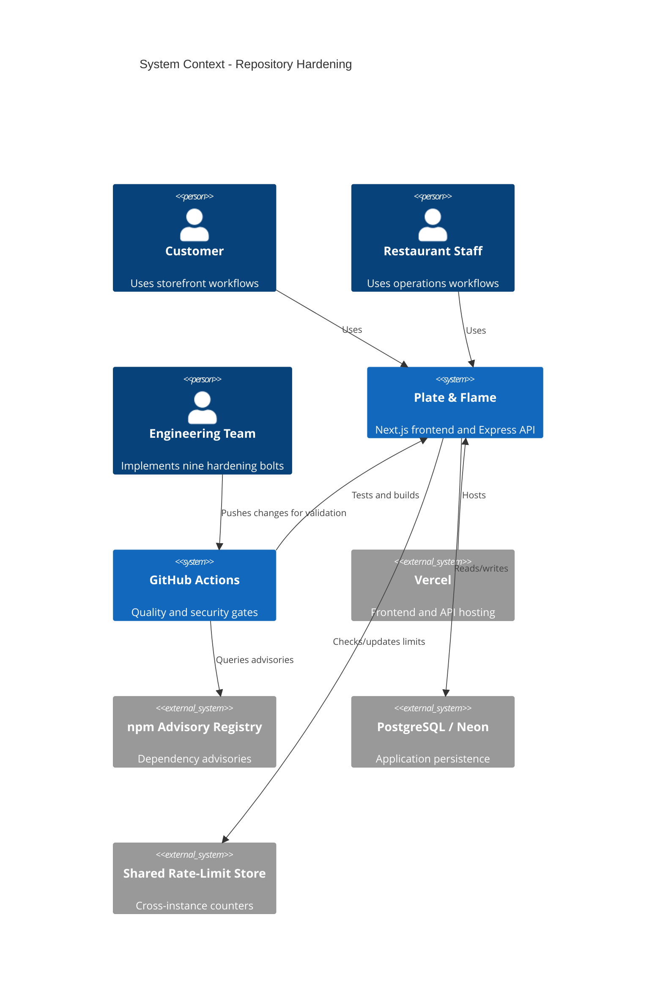

# Repository Hardening - System Context

## System Overview

This intent hardens the existing Plate & Flame monorepo and delivery path. It changes engineering controls and runtime safeguards while preserving restaurant customer and staff workflows.

## Actors

- **Customers** (Human): Use storefront ordering, booking, accounts, and receipts.
- **Restaurant staff** (Human): Use role-specific operations screens and API workflows.
- **Nine-member engineering team** (Human): Own and review one planned bolt each.
- **Maintainers/reviewers** (Human): Approve dependency, architecture, and release changes.
- **GitHub Actions** (System): Installs, validates, tests, audits, and builds changes.
- **Vercel** (External system): Hosts the frontend and API as separate projects.
- **npm advisory registry** (External system): Supplies production dependency vulnerability data.
- **PostgreSQL/Neon** (External system): Stores relational application state; not modified by this intent except for a possible rate-limit adapter decision.
- **Shared rate-limit backend** (External system, TBD): Coordinates deployment-wide limit counters.

## Context Diagram

## Data Flows

### Inbound

- Git commits, pull requests, dependency manifests, and configuration enter CI.
- HTTP requests enter the Next.js frontend and Express API.
- Advisory metadata enters the dependency audit gate.
- Rate-limit decisions and counters enter API middleware from a shared adapter.

### Outbound

- CI publishes validation results and failure artifacts.
- Vercel deployments expose the validated frontend and API.
- The browser receives production bundles that must exclude demo-only workforce data.
- The API emits standard responses plus `429`/`Retry-After` when limits are exceeded.

## External Integrations

- **Vercel**: Build/runtime environment and rewrite handling.
- **GitHub Actions**: CI orchestration.
- **npm registry/advisory service**: Package resolution and vulnerability metadata.
- **PostgreSQL/Neon**: Existing application persistence.
- **Shared limit store**: New integration chosen during Bolt 004 planning.

## High-Level Constraints

- No production-data access during construction or testing.
- Preserve public routes, role permissions, cookie security, and current business rules.
- Dependency upgrades must be validated by browser-level smoke coverage.
- Production configuration must never silently fall back to localhost.

## Key NFR Goals

- Zero unapproved high or critical production advisories.
- Deployment-wide rate-limit consistency.
- Single-flight recurring requests and no stale state updates.
- Deterministic CI, one lockfile authority, and faster frontend tests.
